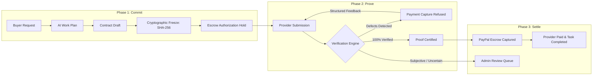

# WorkPay: Autonomous Agent Milestone & Escrow Protocol

WorkPay is a trustless milestone commitment and automated escrow protocol for autonomous software agents and human professionals.

Autonomous AI agents can negotiate contracts, write code, and analyze datasets: but until now, they could not be trusted with money. Current systems either hallucinate approvals or force humans to micro-manage every single transaction. WorkPay solves this through a cryptographic three-phase lifecycle: **Commit -> Prove -> Settle**.

Funds are held in real payment escrow and are released only when deliverables satisfy verified, deterministic acceptance criteria.

---

## The Three-Phase Protocol: Commit -> Prove -> Settle



1. **Commit:** The buyer specifies a task and budget ceiling. The buyer agent structures the goal into discrete requirements and deterministic acceptance rules. Once approved, the contract terms are frozen into an immutable SHA-256 hash snapshot, and funds are authorized into escrow.
2. **Prove:** Upon deliverable submission, the verification engine runs deterministic checks first (for example uniqueness, null checks, schema validation) followed by bounded semantic assessments. If any defects exist, payment capture is strictly refused.
3. **Settle:** When all acceptance criteria pass with zero defects, escrow capture executes immediately without human latency. If a check is uncertain, funds remain locked and the case routes to human arbitration.

---

## The Four Core Invariants

WorkPay mathematically enforces four invariants that protect buyer capital and provider labor:

| Invariant | Guarantee | Technical Implementation |
| :--- | :--- | :--- |
| **P1: Frozen Scope** | Approved contract terms cannot be secretly altered. | Full plan snapshot is hashed with SHA-256. Submissions must reference the exact contract version and hash. |
| **P2: Zero-Defect Escrow** | No payout is ever released against a defective deliverable. | Gateway capture calls require proof of zero failures. Defective submissions immediately reject payment release. |
| **P3: Budget Cap Bound** | Negotiated settlements can never exceed the buyer ceiling. | Agent negotiation policies reject counteroffers above the authorized budget. |
| **P4: Dispute Escalation** | Uncertainty or unresolvable disputes never stall funds silently. | Submissions with uncertain checks route to the Human Review queue with complete cryptographic event logs. |

---

## Execution Environments

WorkPay ships with a hybrid runtime architecture designed for testing, integration, and production escrow deployments:

### 1. Sandbox Environment (Default)
- **Zero Friction Evaluation:** Evaluators and engineers can explore all protocol flows without mandatory account registration.
- **Actor Perspectives:** Switch between **Alice (Client)**, **Bob (Specialist)**, and **Carol (Arbitrator)** with one click in the navigation header.
- **Protocol State Reset:** Reset the database to clean protocol fixtures directly from the perspective menu.

### 2. Live Production Escrow
- **Protected Routes:** Next.js middleware guards `/tasks`, `/provider`, `/review`, and `/payments`, redirecting unauthenticated visitors to `/login`.
- **Session Security:** Cryptographic session tokens stored in HTTP-only cookies, combined with scrypt password hashing for identity management.
- **Activation:** Set `WORKPAY_MODE=production` and `NEXT_PUBLIC_DEMO_MODE=false` in `.env`, or toggle via the environment switch in the navigation header.

---

## System Architecture & Tech Stack

WorkPay is structured as a modular TypeScript monorepo managed with pnpm workspaces:

```text
workpay/
├── apps/
│   ├── web/           # Next.js 15 App Router web application and REST API endpoints
│   └── worker/        # Asynchronous background job worker (pg-boss queue)
├── packages/
│   └── shared/        # Core business domain, Drizzle ORM schemas, verification engine, AI adapters
├── architecture/      # Detailed formal specifications and engineering constitution
└── scripts/           # Live rehearsal harness and automation utilities
```

- **Frontend & API:** Next.js 15 (App Router, Server Actions, Route Handlers), React 19, Vanilla CSS design system.
- **Database & Storage:** PostgreSQL 16, Drizzle ORM, S3-compatible local or cloud storage.
- **Background Worker:** Node.js worker powered by pg-boss for durable job processing.
- **AI Planning Engine:** Cloudflare Workers AI (`@cf/meta/llama-3.3-70b-instruct-fp8-fast`) with automated schema validation and deterministic rule synthesis. Also supports Google Gemini, Groq, and OpenAI.
- **Payment Gateway:** PayPal Sandbox API (`AUTHORIZE -> HOLD -> CAPTURE`) with fallback adapter for offline development.
- **Public Connectivity:** Cloudflare Tunnel for secure, zero-config HTTPS public edge routing.

---

## Quickstart & Local Setup

### 1. Prerequisites
- Node.js 22+
- pnpm 9+
- PostgreSQL 16 (or Docker Compose)

### 2. Installation
```bash
git clone https://github.com/saleke/workpay.git
cd workpay
pnpm install
```

### 3. Environment Configuration
Copy the sample environment file:
```bash
cp .env.example .env
```

Default configuration runs in Demo Mode with local PostgreSQL on port 5433 and Cloudflare Workers AI.

### 4. Database Setup
Start PostgreSQL (if using Docker):
```bash
docker compose up -d postgres
```

Run database migrations and seed baseline fixtures:
```bash
pnpm --filter @workpay/shared db:migrate
pnpm --filter @workpay/shared reset-demo
```

### 5. Running the Application
Start the background worker in one terminal:
```bash
pnpm --filter @workpay/worker dev
```

Start the Next.js web application in a second terminal:
```bash
pnpm dev
```

The application will be live at `http://localhost:3000`.

---

## Live End-to-End Rehearsal

WorkPay includes an automated rehearsal harness that validates the complete fail-then-pass lifecycle:

```bash
pnpm tsx scripts/rehearse-demo.ts
```

What the rehearsal verifies:
1. Creates a buyer task with a natural language specification and budget ceiling.
2. Invokes AI planning to draft a contract with structured requirements.
3. Approves the contract and freezes the SHA-256 hash snapshot.
4. Matches an active provider, negotiates terms, and authorizes escrow hold.
5. Uploads flawed deliverable v1 (7.2% duplicates) and proves payment capture is refused.
6. Uploads clean deliverable v2 (0% duplicates), passes verification, and triggers PayPal capture.

---

## Testing & Quality Assurance

- **Typecheck:** `pnpm typecheck` (Strict TypeScript across all workspaces)
- **Unit & Integration Tests:** `pnpm test`
- **Database Integration Tests:** `pnpm test:integration`

---

## License

MIT License. Built for the autonomous agent economy.
